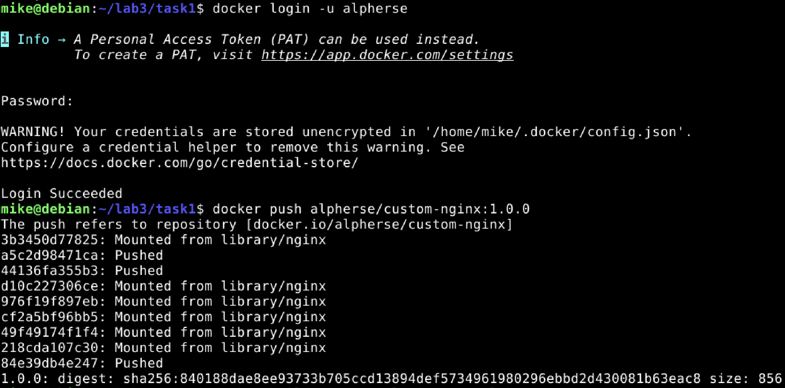
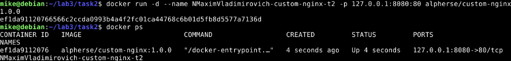
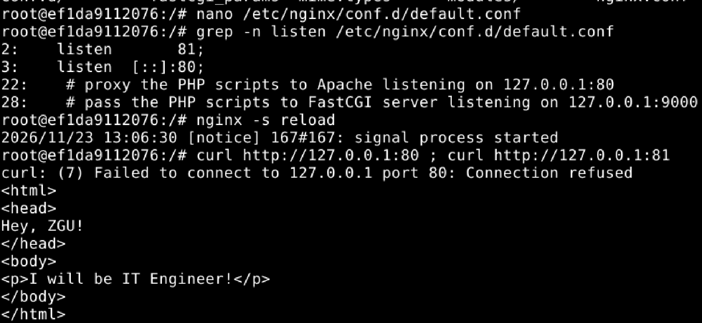
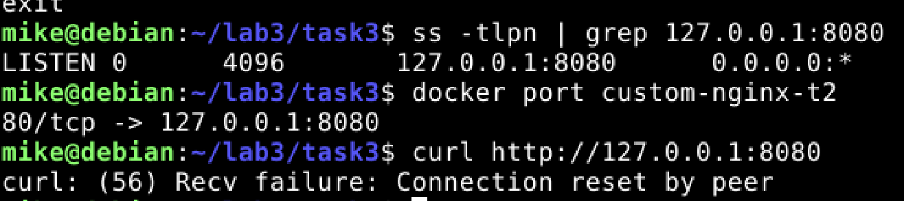
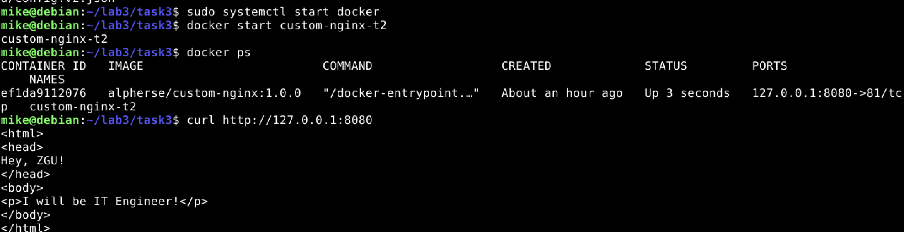

# lab3-docker

## задача 1

[docker hub](https://hub.docker.com/r/alpherse/custom-nginx)

## задача 2

## задача 3

объяснение: терминал подключился к потокам процесса контейнера (nginx, который просто ждал запросов - поэтому ничего не было). делая ctrl+c, отправляется сигнал 2, который вызывает завершение процесса. сам nginx является главным процессом контейнера, поэтому вместе с ним оффнулся и контейнер

суть проблемы: несовпадение портов. docker продолжает перенаправлять запросы с порта 8080 системы на порт 80 контейнера, но после изменения конфигурации nginx слушает порт 81, поэтому запросы не обрабатываются и соединение сбрасывается

### доп задание

для изменения проброса портов без пересоздания контейнера были отредактированы два файла конфигурации docker:

- hostconfig.json: в PortBindings изменен порт контейнера с 80/tcp на 81/tcp (порт хоста 127.0.0.1:8080 остался прежним)

- config.v2.json: в ExposedPorts изменен порт с 80/tcp на 81/tcp

