# ИТ/ЛР3/КОНТЕЙНЕРИЗАЦИЯ

## Задача 1

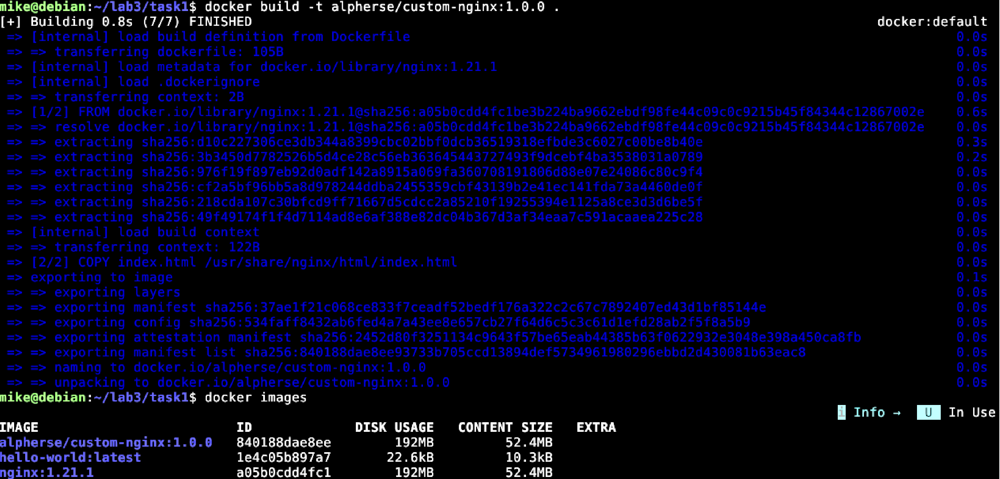

[Docker hub](https://hub.docker.com/r/alpherse/custom-nginx)

## Задача 2

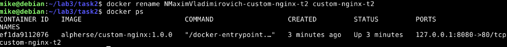

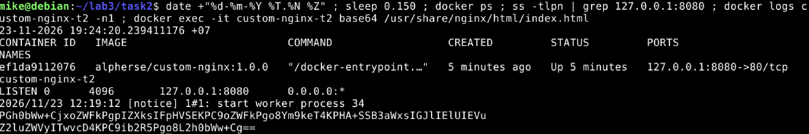

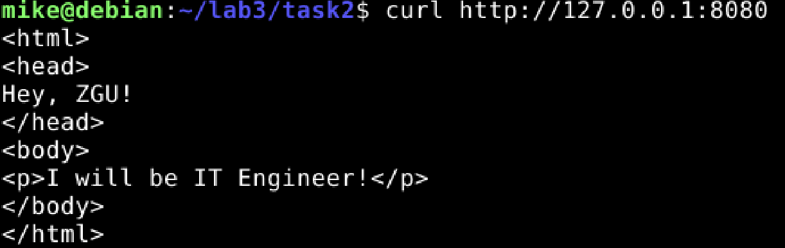

## Задача 3

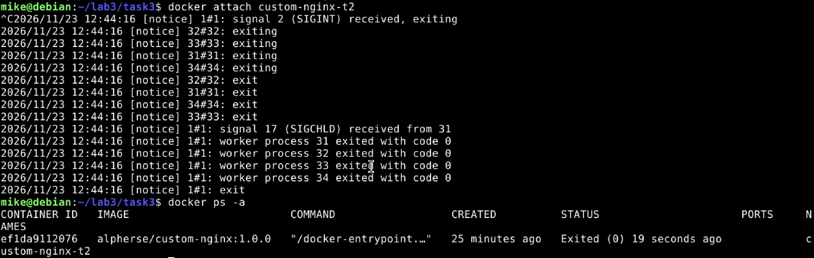

**Объяснение: терминал подключился к потокам процесса контейнера (nginx, который просто ждал запросов - поэтому ничего не было). делая ctrl+c, отправляется сигнал 2, который вызывает завершение процесса. сам nginx является главным процессом контейнера, поэтому вместе с ним оффнулся и контейнер**

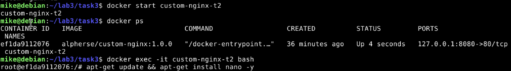

**Суть проблемы: несовпадение портов. docker продолжает перенаправлять запросы с порта 8080 системы на порт 80 контейнера, но после изменения конфигурации nginx слушает порт 81, поэтому запросы не обрабатываются и соединение сбрасывается**

### Доп. задание

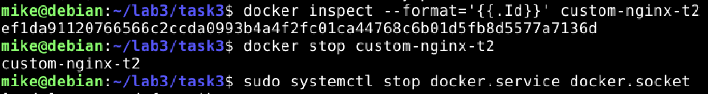

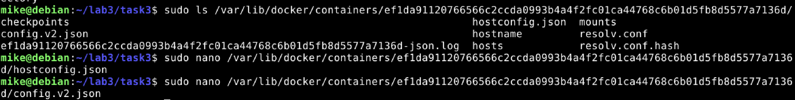

**Для изменения проброса портов без пересоздания контейнера были отредактированы два файла конфигурации docker:**

- hostconfig.json: в PortBindings изменен порт контейнера с 80/tcp на 81/tcp (порт хоста 127.0.0.1:8080 остался прежним)

- config.v2.json: в ExposedPorts изменен порт с 80/tcp на 81/tcp

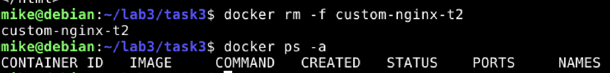

## Задача 4

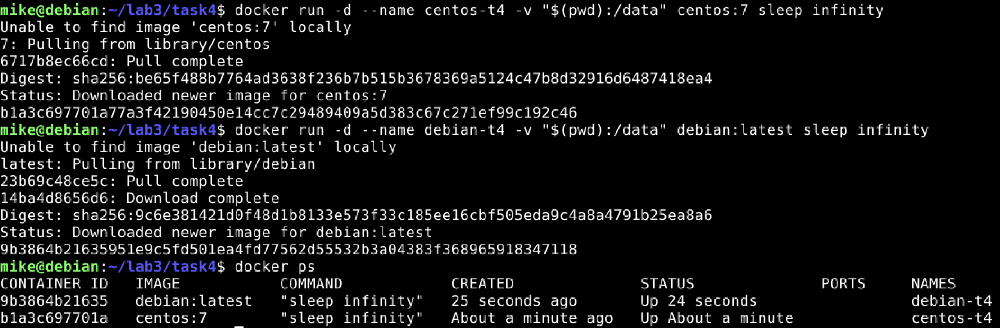

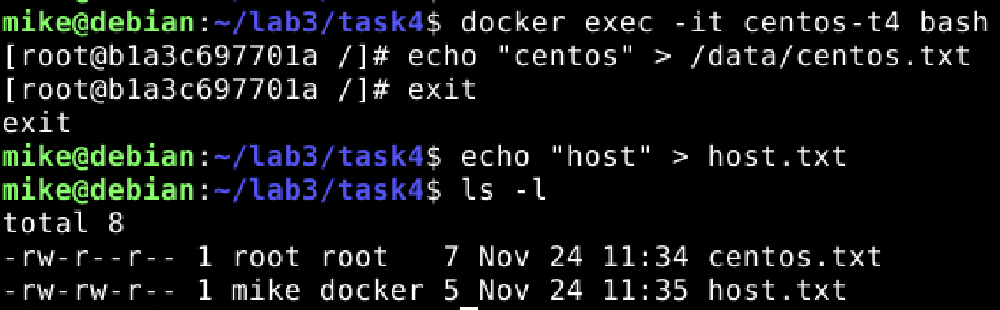

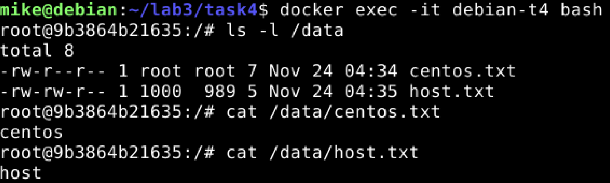

## Задача 5

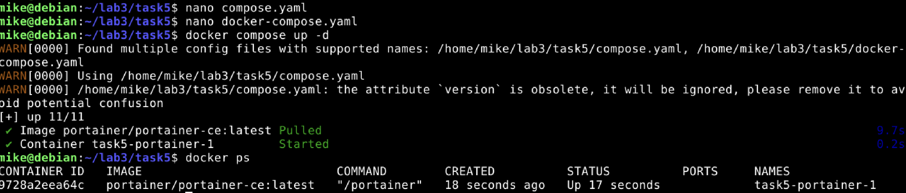

**Объяснение: был запущен compose.yaml, так как это приоритетное имя файла конфигурации docker compose. а docker-compose.yaml поддерживается для обратной совместимости**

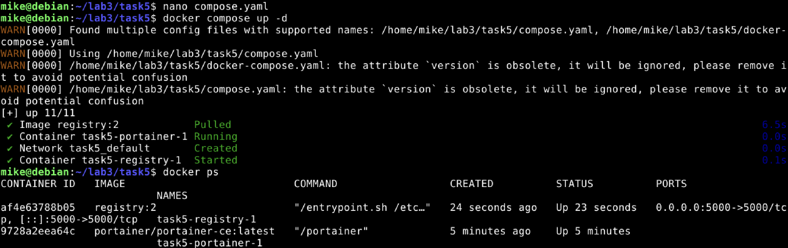

[compose.yaml](assets/task5/compose.yaml)

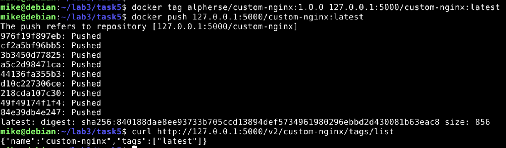

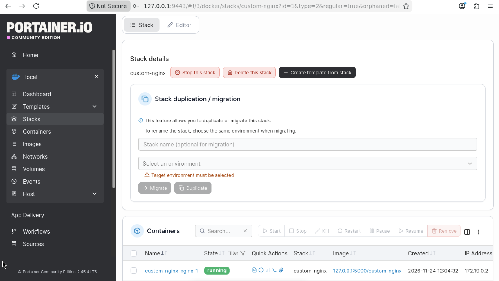

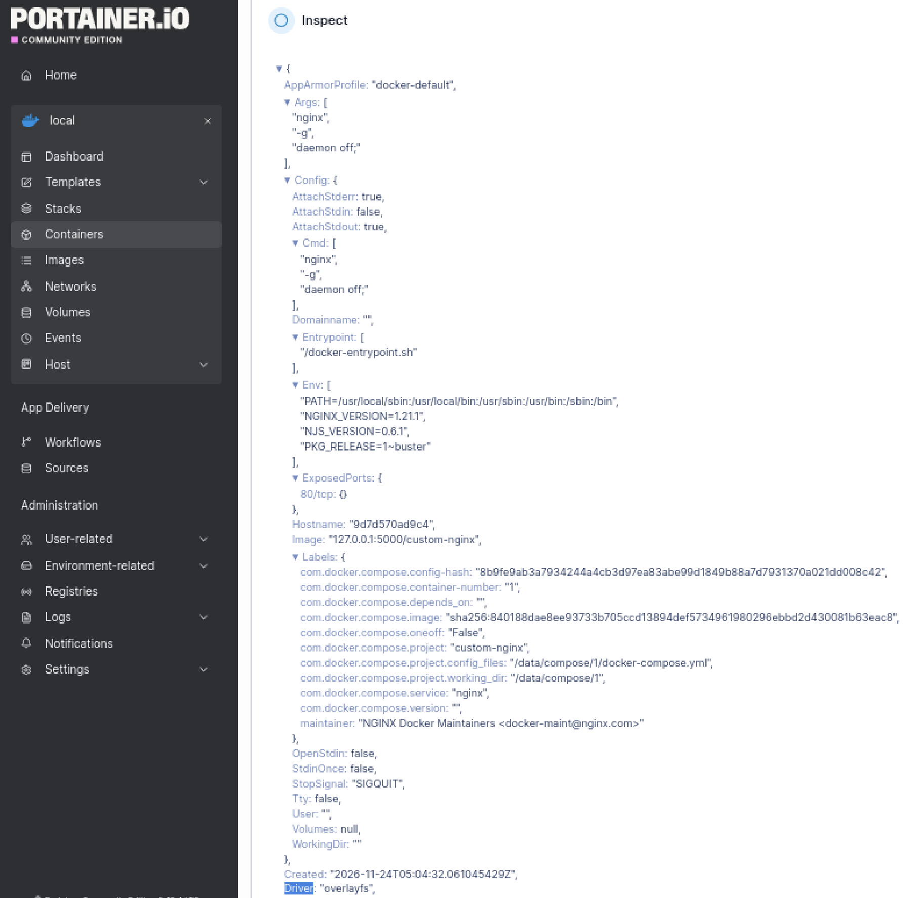

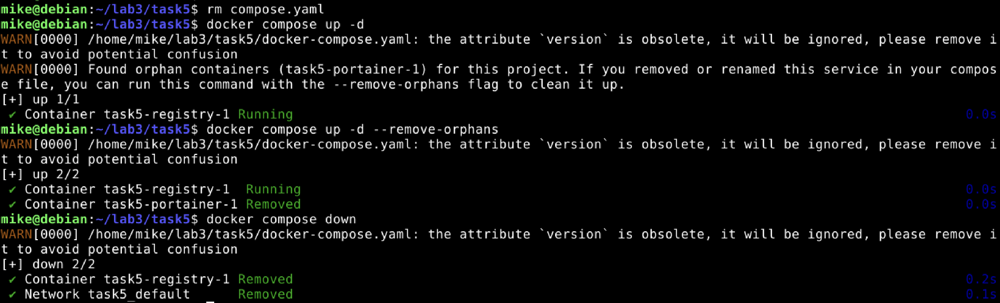

**Суть предупреждения: после удаления compose.yaml контейнер portainer остался запущенным, хотя его сервис больше не описан в конфигурации. для его удаления использован флаг --remove-orphans**